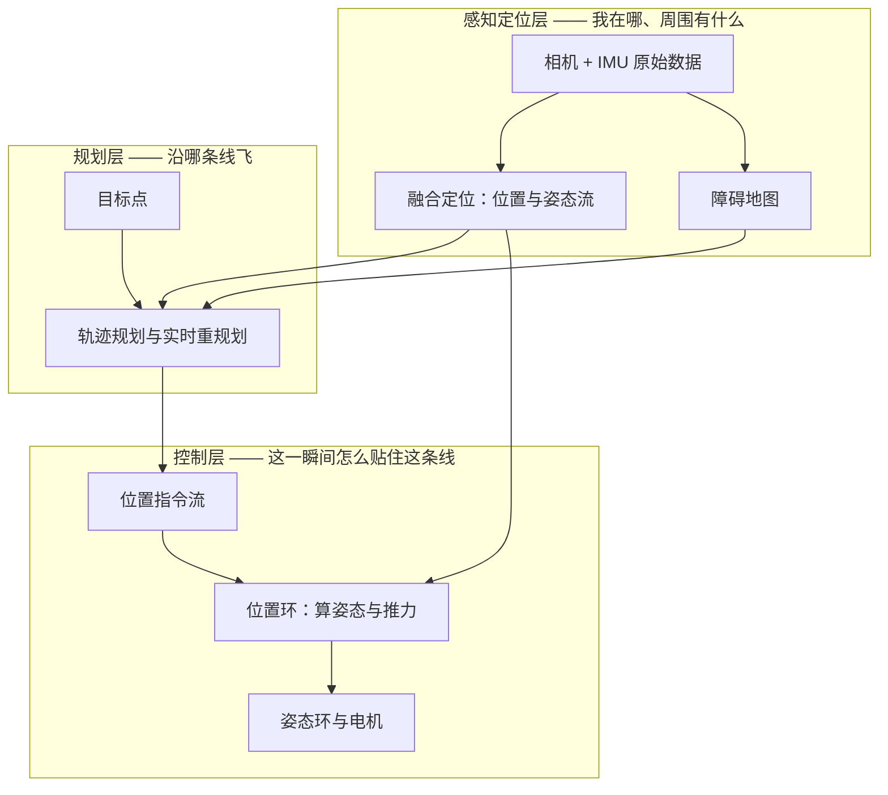
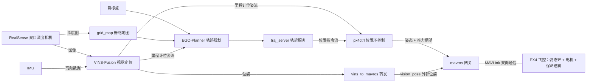
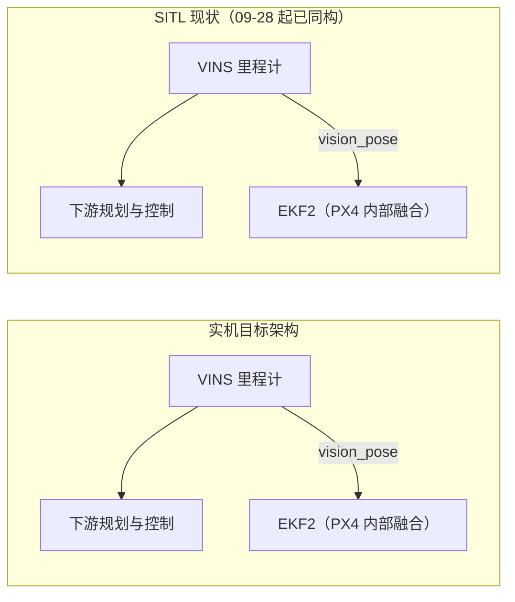
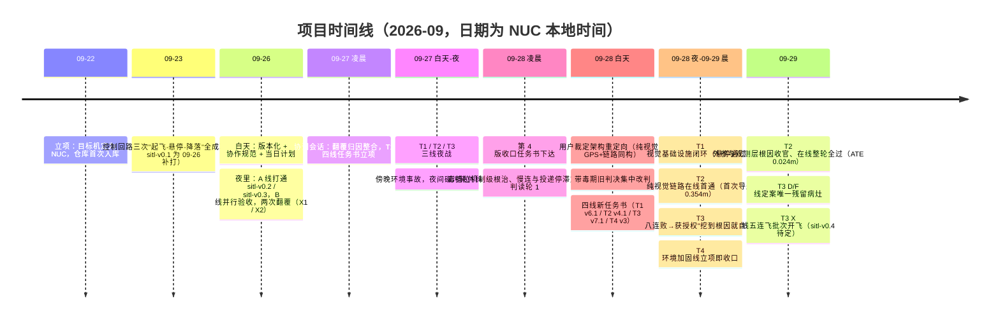

# 项目进度与未来方向（入门友好版）

> **这份文档是什么**：为接手本项目的人写的"入门讲解 + 接手地图"。读者画像：资深嵌入式工程师（Keil / JLink / 串口 / RTT 工具链熟练），无人机与视觉定位零基础，这是他第一个相关项目。
>
> **信息截止时点**：**v3=2026-10-11 深夜（实飞前夜）**。正文 §1-§9 为 v2（09-29 晚）原文存史；**§10 为 v3 增补章**——覆盖 09-30 至 10-11 的全部新状态（SITL 收官+tag sitl-v0.4+实机地面链+安全体系+软件清零态），并指向新的深度正源《项目总结报告》（A/B 双执行者独立版，`项目总结报告_v1A|v1B_实飞前夜.md`，见 §10.4/§10.5）。**本项目状态是滚动变化的**——git 提交、仿真锁、任务进度都在持续推进，本文所有"当前"类表述只代表截止时点；接手后如何核实现状，见 §8.2。
>
> **事实纪律**：首版事实来自事实底稿（经独立复核，含"存疑"标注）；本次更新的增量事实来自 NUC 现场 git/台账直读与各任务线执行会话的长期记忆，关键数字均随文标注依据（提交主题、台账行、证据文件）。核实不到的一律写"存疑"，不脑补。文中少量"（底稿 §x.x）"标注供溯源。

---

## 1. 写在前面

**本节一句话**：先说清这份文档怎么读、读的时候要避开什么坑，再进入正题。

### 1.1 读者路由表

| 你是谁 | 想干什么 | 建议路线 |
|---|---|---|
| 只想了解现状 | 5-10 分钟搞清楚项目做到哪了 | §2 → §5 → §6 → §7。注意：§5 代号密集（任务线编号、异常编号），行话随手查 §9；跳读时只看每段首尾句即可抓住主线 |
| 想接手开发 | 建立完整认知并开始动手 | §2 → §3 → §4 打底，然后 §8 落地；§5 / §6 当地雷图，§9 全程当字典 |
| 查术语 | 读到一半忘了某个词 | 直接翻 §9 速查表 |

### 1.2 两个阅读警告

**警告一：本机文档是滞后快照。** 本机 `D:\drone_VINS` 目录下的 `README.md` 停在 09-26 白天——README.md:62 仍宣称"规划器尚未接入仿真回路"，而这个缺口当天夜里就已关闭；`docs/flight_log.md` 更只到 09-23（本地仅 3 行，NUC 侧同名文件已数十条、记录至 09-29）。**核实现状一律以 NUC 侧的 git 记录与 STATUS 台账为准**（方法见 §8.2），本机文档只能当"过期照片"看。

**警告二：术语只在第一次出现时解释。** 正文所有术语和代号在首现处就地解释（加粗），讲过一遍后文不再重复；更完整的"术语 + 类比 + 类比哪里不成立"汇总在 §9。文中出现的个别配置类数字（版本号、IP 地址）属于事实陈述，不是调参建议。另外：本文类比大量借用嵌入式工程的本行锚点（CAN、Modbus、逻辑分析仪、测试桩等），服务于主要读者（嵌入式工程师）；不熟悉这些锚点的读者请把类比当"方向提示"而非精确映射，一切以每条"是什么"的正文描述为准——纠偏半句里的行话同样可在 §9 查到。

先回答最基本的问题：这个项目到底在做什么？——下一节。

---

## 2. 项目在做什么

**本节一句话**：在一台叫 NUC 的机载小电脑上，完整复现浙大开源的 250mm 自主无人机全栈，并按"仿真验证通过才上实机"的纪律分四个阶段推进。

### 2.1 项目本体与四个核心组件

项目基于 **Fast-Drone-250**——浙大 FAST-Lab 开源的完整自主飞行栈（感知、规划、控制全套代码）。"复现"= 让这套栈在自己的硬件上从仿真到实机完整跑通。四个核心组件（§3 逐个展开）：

| 组件 | 回答的问题 |
|---|---|
| **VINS-Fusion**（视觉惯性定位算法） | "我在哪" |
| **EGO-Planner**（局部避障轨迹规划器） | "沿哪条线飞" |
| **px4ctrl**（机载位置控制节点） | "这一瞬间怎么飞" |
| **mavros + PX4**（通信网关 + 飞控固件） | "把上层意图变成电机转速" |

### 2.2 上下位机分工

实机上有两台电脑：**PX4**（开源飞控固件，跑在单片机级硬件上，本项目用 v1.17.0 版本）负责硬实时的下层——姿态环和电机输出，自带传感器驱动、状态估计器和 **failsafe**（保命逻辑：失控时自动进入悬停/降落等安全状态）；**NUC**（Intel x86 小主机，可理解为"装在飞机上的迷你 Linux 主机"）负责重算力的上层——视觉定位、轨迹规划、位置环控制。

先补一个贯穿全文的词：**控制环（闭环控制）**——持续"测量 → 算误差 → 修正输出"的反馈循环；"XX 环"就是围绕 XX 这个量转的循环——位置环管"位置贴住目标"，姿态环管"姿态贴住期望"，位置环的输出正是姿态环的期望。

类比：就是上下位机分工——NUC ≈ Linux 主控板，PX4 ≈ 专用电机控制 MCU。**不成立之处**：安全责任不是上位机独占，PX4 不是被动执行器，两级是"协商"关系而非"指令直通"。

### 2.3 目标机

最终目标机是 NUC（主机名 uav4，IP 192.168.0.5，Ubuntu 20.04.6 + ROS Noetic——**ROS** 是机器人软件框架，§3 详述），不是你手头的 Windows 机器，也不是 **WSL2**（Windows 上的 Linux 子系统）——这一点立项时被显式纠正过。

### 2.4 三套编号对照表（全文解码器）

| 编号体系 | 是什么 | 本文出现的取值 |
|---|---|---|
| **P1-P4**（阶段） | 里程碑目标 | P1 避障稳定化 → P1 收口 → P2 定位同源化 → P3 实机准备 → P4 首飞 |
| **sitl-v0.x / real-v0.x**（tag） | known-good 存档点（见下） | sitl-v0.1 / v0.2 / v0.3 已打；sitl-v0.4 未打——**重定向后它是唯一在冲的下一站**（旧规划的 sitl-v0.3.1 已并入其中）；real 族不存在 |
| **T1-T4**（任务线） | 施工队编号，09-27 凌晨设立（§5.4 正式登场），09-28 重定向后改组（§5.7） | T1 控制健壮化+视觉基础设施 / T2 VINS 质量 / T3 规划质量+视觉验收 / T4 视觉验收+SITL 环境运维 |

口诀：**阶段是目标，tag 是证据，任务线是干活的人。**

**SITL**（Software In The Loop，软件在环仿真）：把真正的 PX4 固件代码编译成电脑上的普通进程来跑，传感器输入来自仿真环境——代码是真的、外设是假的。类比：把固件编译成 PC 测试桩联调。**不成立之处**：连时间都是仿真时钟（可加速、可倒跳），凡依赖定时器和时间戳的路径，仿真过了不等于真板过了。**tag**（git 标签）：给某个代码版本钉永久名字，本项目只把验收通过的版本打成 tag，出问题时整体回退到"最后一个确认能飞"的版本。

### 2.5 做到什么算成功

| 阶段 | 验收线 | 现状（截止 09-29 晚） | 责任线 |
|---|---|---|---|
| P1 避障稳定化 | tag sitl-v0.3：避障**三连飞** 3/3（连续三次全流程飞行全部成功） | ✅ 09-26 达成 | A 线（B 线复核通过） |
| ~~P1 收口~~（sitl-v0.3.1） | 旧规划的一站，09-28 重定向后**并入 sitl-v0.4**，不再单独打 | — | — |
| P2 定位同源化 | tag sitl-v0.4：VINS 同构链路**五连飞** 5/5（含到位误差 ≤0.5m 门） | 🔶 **在线闭环已整轮全过**：双航段到位 0.387 / 0.349m（返程腿顽疾首次清除），定位误差 ATE@60s 0.024m；但单轮通过率约一半（慢漂所致，§6），**五连飞批次 09-29 晚正在飞，5/5 即打 tag** | T2（✅ 根因收官）→ T3（进行中） |
| P3 实机准备 / P4 首飞 | tag real-v0.x | ⬜ 零启动，无任何实飞——这是纪律不是事故；实机检查单已备好（§7.2） | 未分配（路线图占位） |

表中 **A 线 / B 线** 是 09-26 单夜的两条执行线（A 线为工程线、B 线为视觉验收线，来历见 §5.3）——它们是 T1-T4 的前身。另注意 P2 的验收形态在重定向中升级过一次：从"打通一次"升级为"**连续五次都过**"——§5.9 会解释为什么（一次性过线 ≠ 稳定过线）。

### 2.6 P2 的真正含义（最容易被误解的一点）

**里程计（odom）**：持续输出"我现在在哪、朝哪、速度多少"的定位数据流，规划器和控制器都吃这一路数据。实机的目标架构里，这路数据**直连 VINS**；SITL 仿真里目前临时用 PX4 内置估计器 **EKF2**（扩展卡尔曼滤波——PX4 自带的"多传感器融合出位姿"模块）的输出**顶替**。

**P2 = 把仿真的 odom 源换成 VINS，与实机同源**——不是绕开 EKF2，而是换数据源头，让仿真验证的结果对实机有代表性。类比：给上层统一封装的"位置信息 API"——设计意图是底层换源、上层接口不动。**但实战难点恰在类比不成立之处**：不同源的坐标原点、时钟、噪声特性全不同，换源等于整套下游要重新适配（P2 的工作量正在这里；本项目后文最大的机制性 bug 也正是出在"时钟"这一项）。

**现状（09-29）**：这一步已经完成——仿真的规划与控制现在直接吃 VINS 里程计（§5.8），而"重新适配"的代价也如预言般逐项兑现：坐标原点差异引爆了"出生点平移假象"（§5.7），噪声特性差异引爆了观测层与噪声参数两案（§5.9）。EKF2 并未退场：它仍在 PX4 内部融合 vins_to_mavros 转发的视觉位姿，服务 PX4 自己的状态机——并在这个角色下暴露了新问题（§6 卡点一的 EKF2-EV 项）。

### 2.7 架构红线（09-28 重定向，全文最高约束）

用户 09-28 裁定两条根本原则，落成 README §0 的 **R1-R6 六条规则**，此后所有工作以它为"宪法"：

- **纯视觉导航，不许依赖 GPS**：实机上没有 GPS；仿真器注入的 GPS 只是流程代位品——在代位链路上精调的参数（罗盘配方、GPS 航向流程）对实机零迁移价值。项目曾差点把"先飞 2 米建立 GPS 航向"写成修复配方，被这条红线拦下。
- **仿真-实机链路同构**：仿真里跑的节点拓扑必须与实机一致，差异只允许两类——传感器几何的物理必然，或逐条登记在案的已论证差距（现行差距表六项：相机焦距、避障膨胀系数、IMU 频率口径、外参、PX4 固件版本等）。

配套细则：定位层的验证必须走 VINS 链路；GPS 代位链路仅限流程/规划/控制层验证且须显式标注；每个修复入库前过合规检查；验收口径全组统一；实机永远零 GPS。

组件和判据里出现了不少新词。下一节用最少的篇幅把它们一次讲清，之后全文只复用、不新教。

---

## 3. 预备知识小课堂

**本节一句话**：自主飞行软件按职责分"感知定位 → 规划 → 控制"三层，本节按层组织最小概念集，每个概念讲清"是什么、解决什么问题、类比在哪里不成立"。

### 3.1 感知定位层

**双目深度相机（RealSense）**——无人机的"眼睛"。**VINS** 用它的图像做特征跟踪定位，规划层用它的**深度图**（每个像素到障碍物的距离）建障碍地图。深度不是直接量出来的，是左右两目图像视差匹配"算"出来的，弱纹理和反光区域会算错。类比：一对必须同步的传感器；**不成立之处**：深度是推导量而非直接量测，可靠性模型和"读到啥是啥"的 ADC 完全不同。

**VIO / VINS-Fusion**——VIO（Visual-Inertial Odometry，视觉惯性里程计）：用相机图像 + IMU 数据融合解算"机体此刻的位置与姿态"。视觉负责长时间不漂（看到同一批图像特征就能对上），IMU 负责高频补间（两次拍照之间的运动靠它推算）。不依赖 GPS，是室内实机的主要定位源。弱点有二：**初始化脆弱**（本项目 A 线收官项卡死的一半原因在初始化）——所谓**初始化**，就是起飞前为整套估计器一次性估好"起点"：重力方向对齐、初始速度与各类偏置、下文的相机-IMU 外参等，起点没定准，后面全盘皆错；**会漂移**——漂移量与飞行剖面和配置强相关；本项目对它的认知后来被大改过一轮（§5.7/§5.9）：一些吓人的"大漂移"读数，其实是坐标零点没对齐的假象、或失控机动的后果，并非缓变渐漂。类比：航位推算的升级版——IMU 积分走距、另一路传感器压漂移，和陀螺积分加轮速修正一个思路；**不成立之处**："另一路"是相机特征匹配，像一只会跟丢（遮挡、弱纹理、剧烈运动）的软尺，不是物理上必然可靠的轮子。

**IMU**（Inertial Measurement Unit，惯性测量单元）——一颗芯片集成三轴加速度计和三轴陀螺仪，输出"受多大力、转多快"，是飞控和 VINS 共用的高频心跳。单靠它积分算位移会迅速漂走，必须靠视觉不断修正。工程要点：它的采样率和时间戳对齐是**系统级参数**——本项目在这上面翻过一轮大案：链路默认 50Hz 起步，"提到 200Hz"一度被判不可达，最终定案是三层叠加的故事（默认档在固件里硬编码 → "125Hz"是仿真时钟网格的量化假象 → 对齐网格后实测 223Hz，而物理上游其实一直是 250Hz），实机侧则一次性把固件的 IMU 积分率设成 250Hz 即可（三层定案见 §5.7，实机检查单见 §7.2）。类比：就是天天打交道的六轴 IMU 芯片；**不成立之处**：它不是"读一下就行的外设"，而是状态估计的核心数据源。

**状态估计 / EKF / EKF2**——没有单一传感器能直接给出精确位姿；状态估计把 IMU、气压计、磁力计、视觉位置这些各有噪声的数据按可信度加权融合成一套平滑可信的"位置+速度+姿态"，核心是"预测–修正"递推。PX4 固件内置的这套叫 **EKF2**（§2 已露面）。它对输入质量敏感：没门控的脏视觉位置直灌进去会拖垮整个估计——09-26 夜第二次翻覆（X2，§5.3）判读与此机制高度吻合。类比：你在 MCU 里写的互补滤波/简易卡尔曼；**不成立之处**：EKF2 状态量大得多，坏输入的失效方式（每帧看着都正常、整体平滑漂 60m）远比小滤波器"炸一下"隐蔽。

**相机标定与外参**——相机要参与定位必须先标定：**内参**（intrinsics）是镜头自身的焦距与畸变参数；**外参**（extrinsics）是相机与 IMU 之间的安装相对位姿；**td** 是图像与 IMU 数据之间的时间偏差。本项目实机链路 2026-06 已按实际硬件标定完成，仿真配置照抄实机——后来发现这"照抄"本身埋了一颗雷：仿真支架与实机支架的尺寸根本不同，抄来的外参在仿真里是错的（§5.9 排雷）。VINS 支持在线自标定（边飞边估外参），但需要足够的**运动激励**——即让待估参数都能"被数据区分开"所需的运动组合（足够的加速度与旋转变化）；飞得太温柔、轨迹太单调，参数的影响混在别的因素里估不出来，就会发散（A 线卡死原因之一）。类比：加速度计六面标定同源；**不成立之处**：相机-IMU 外参是"空间+时间"的双重关系，要靠持续运动来估，静态跑一遍标定脚本的做法在这里不适用。

### 3.2 规划层

**grid map（栅格地图）**——把空间切成小方块、标记是否被占用，本项目由深度相机数据实时更新。难点：相机没看到的地方地图是空的——"盲图穿箱"（规划器以为没路其实有箱）由此而来（§5.5）。

**EGO-Planner**——浙大 FAST-Lab 开源的局部轨迹规划器：输入栅格地图 + 目标点，输出一条平滑、绕障、动力学可执行的轨迹，环境变了还会滚动重规划。轨迹与障碍物的最小距离要过验收阈值（P1 的"避障净空"验收项）。它高度依赖地图质量——**轨迹质量的上限被地图质量卡死**。类比：运动控制里的 S 曲线规划（给定起止点、生成平滑限加速度的轨迹）；**不成立之处**：它不是拿全局地图一次规划，而是边飞边在残缺的局部地图上滚动重规划。

**traj_server（轨迹服务节点）**——把 EGO-Planner 的轨迹折算成约 100Hz 的实时位置指令流，是规划层与控制层的接口。类比：CNC 插补器/轨迹发生器——把离散轨迹点匀速喂给位置环。

### 3.3 控制层

**px4ctrl**——机载控制节点：吃上层发来的位置指令流，用 PID 类反馈算出姿态和推力期望发给 PX4；内部维护"手动/悬停/指令"状态机和**解锁握手**流程（与飞控确认"我可以接管了"，期间靠 **offboard 心跳**保活——offboard 即机载电脑接管控制权的模式，心跳中断就要原地保命）。本项目大量修改集中在这层，且多数 bug 不在控制律、而在时序和状态迁移上。类比：上位机里的运动控制任务；**不成立之处**：它套着一层"必须与飞控握手"的协议状态机。

**MAVLink 与 mavros**——**MAVLink** 是 PX4 与外界（机载电脑、地面站）之间标准化的消息协议，像一套定义好 ID 和发布周期的报文表；**不成立之处**：单条消息的速率不是配多少就是多少，而是受整条链路带宽和调度节拍硬顶（IMU 提频就卡死在这里）。**mavros** 是 ROS–飞控网关节点：一头用 MAVLink 和 PX4 通信，一头把飞机状态和指令翻译成 ROS 话题，让上层程序不碰协议细节就能操控飞机。它还带转发功能——比如把外部视觉定位（**vision_pose**）喂给 PX4 的 EKF2 融合；本项目教训：这类转发必须加门控，脏数据直灌会拖垮定位（§5.3 的 X2）。网关本身也能成为故障注入点：连接地址配错端口、消息协商丢包，表现都是下游莫名卡死（§5.6）。

**PX4**——开源飞控固件（v1.17.0）：姿态稳定、电机混控、传感器驱动、EKF2、解锁/落地状态机、failsafe。本项目架构里它只干姿态环。类比：完全对应"下位机固件"——硬实时、管 PWM 输出、跑 kHz 级控制环；**不成立之处**：它是带完整自治逻辑的成品固件而非自家代码，上位机只能通过 MAVLink 接口和参数间接影响它。

### 3.4 工程底座（一段带过）

- **ROS 与节点/话题**——程序拆成一个个"节点"，节点之间通过带名字的"话题"发布/订阅传数据，相当于一套命名寻址的消息总线。类比：CAN 上层协议加组件框架；**不成立之处**：ROS 的数据通路是节点上线时**动态协商**建立的，协商本身会随机失败且默认不重试——本项目实测新建发布者到 px4ctrl 的连接约 50% 概率协商丢失（§5.6 的投递停滞定案），静态配置的总线没有这类故障。
- **catkin**——ROS1 的构建系统：一个"工作空间"目录聚合所有功能包，Fast-Drone-250 整个工作空间入库即本仓库。
- **rviz**——ROS 的 3D 可视化工具，把话题数据画成点云、轨迹、障碍块（本项目轨迹截图的出处，也有"空渲染"的坑，§5.3 的 X3）。
- **rosbag**——"总线记录仪"：把话题数据按时间戳录进 .bag 文件，离线回放时数据像当时一样重新流一遍——本项目几乎所有取证和回归测试靠它；坑在于它忠实保留录制时的时钟戳，仿真域和真实域的戳混在一条 bag 里，回放时算法病得比现场还重（§5.6 毒槽位的根源）。类比：逻辑分析仪抓盘回放；**不成立之处**：把当时的时钟域错误也一并忠实保留。
- **Gazebo Classic 11**——3D 物理仿真器：重力、碰撞、推力、虚拟相机与 IMU，障碍物用 .world 文件摆放，与 PX4 SITL 配合成一架完整虚拟无人机；它的传感器永远比真硬件干净，仿真过不等于真机噪声下也能过。

概念就位。下一节把它们对号入座到真实代码模块，并画清数据怎么流。

---

## 4. 系统全景

**本节一句话**：把 §3 的概念映射到真实代码模块——一张数据流图看清全貌，一张模块表找到每块代码，并点明实机链与仿真链的唯一差别。

### 4.1 全景数据流图（实机目标架构）

### 4.2 实机链与仿真链的唯一差别

两条链已完全一致（§2.7 重定向 + §5.8 切换后）：下游规划与控制都直接吃 VINS 里程计；EKF2 在两边都只干同一件事——作为 PX4 内部的融合估计器吃 vision_pose、服务 PX4 自己的状态机与保命逻辑。首版文档"仿真临时用 EKF2 顶替里程计"的说法已成历史。

### 4.3 模块表（解决什么问题 / 输入输出 / 代码在哪）

目录信息来自工作区 README（09-26 快照，结构未变、进度表述滞后，见 §1.2）：

| 模块 | 解决什么问题 | 输入 → 输出 | 代码在哪 |
|---|---|---|---|
| VINS-Fusion | 视觉+IMU 融合定位（不靠 GPS） | 图像+IMU → 高频位姿流 | `src/VINS-Fusion` |
| grid_map（planner 内） | 深度图 → 障碍栅格地图 | 深度图+里程计 → 占据栅格 | `src/planner` |
| EGO-Planner | 局部避障轨迹规划 | 栅格地图+目标点+里程计 → 平滑轨迹 | `src/planner` |
| traj_server | 轨迹 → 实时位置指令流 | 轨迹 → 位置指令流 | `src/planner` |
| px4ctrl | 位置环：位置指令 → 姿态+推力期望 | 位置指令+里程计 → 姿态/推力期望 | `src/px4ctrl` |
| mavros | ROS↔MAVLink 网关 | ROS 话题 ↔ MAVLink 消息 | 系统包 + launch 配置 |
| vins_to_mavros | 起飞阶段给 EKF2 喂视觉位姿 | VINS 位姿 → vision_pose 转发 | `src/vins_to_mavros` |
| PX4 | 姿态环、电机混控、保命逻辑 | 姿态期望 → 电机输出 | NUC 的 `~/PX4-Autopilot`（外部依赖） |
| SITL 流程脚本 | 一键起全套仿真（编号脚本） | — | `sitl_sim/` |
| 纯仿真参照系 | 上游官方纯仿真环境（无实机链） | — | NUC 的 `~/sim_ws`（外部） |

表中"纯仿真参照系"（`~/sim_ws`）的用途：它是上游 EGO-Planner 官方的纯仿真环境（只含规划全套与仿真器，不含 PX4/mavros 链），用于在官方环境里单独验证规划侧功能。

**记住 vins_to_mavros 这条通道**：起飞阶段 PX4 的 EKF2 还没有可靠位置，需要把 VINS 位姿以 vision_pose 形式喂给它融合。§5.3 的翻覆归因、§5.5/§5.6 的门控话题，都发生在"vision_pose 进入 EKF2"的这条路上。

### 4.4 上游差异登记制（本仓库最重要的资产）

**上游** = 本项目所复制的开源原仓库 Fast-Drone-250。本仓库 = 上游 + 少量本地差异，任何对上游已有文件的修改，必须在 README §3 的差异表里登记（文件、改动、原因）；禁止大规模重排上游代码——**"与上游差异可枚举"是复现工作的根基**（docs/workflow.md §3），否则永远说不清"问题出在上游还是自己改出来的"。类比：给三方库打补丁必须维护 patch 清单。差异是否仍然可枚举，需定期与上游做目录级比对（操作见 README §5）。截至 09-26 校验，代码级差异共 4 处修改 + 2 个新增；此后按登记制又陆续入库了 SITL 的 VINS 同构入口（§5.8）等一批改动——现行清单以 README §3 现表为准，本数只是历史快照。

系统长什么样已经清楚。下一节讲它是如何一步步被验证到今天的——包括哪里顺利、哪里翻车。

折叠：关键 ROS 话题名（接手对照用，正文不依赖）

| 话题 | 含义 | 谁发 → 谁收 |
|---|---|---|
| `/vins_estimator/imu_propagate` | VINS 高频位姿输出 | VINS-Fusion → 规划器 / px4ctrl（实机目标架构） |
| `/position_cmd` | 位置指令流 | traj_server → px4ctrl |
| `/mavros/local_position/odom` | EKF2 里程计输出 | mavros → px4ctrl（SITL 临时 odom 源） |
| vision_pose | 外部视觉位姿 | vins_to_mavros → PX4 EKF2 |

---

## 5. 走到哪了

**本节一句话**：从立项到今天共九段，每段按"要解决什么 → 做了什么 → 结果 → 遗留"推进；**本节代号密集**（任务线、tag、X 异常编号），解码器在 §2.4 对照表，逐词释义在 §9——跳读只看每段首尾句即可抓住主线。

### 5.0 各线现状速览（先看这里）

| 任务线 | 负责什么 | 现状（截至 09-29 晚） |
|---|---|---|
| T1 控制健壮化 + 视觉基础设施 | 让控制层在 VINS 数据下稳 | 重锚尖峰修复 + 垃圾数据门**双 PASS 入库**；悬停 0.1m 级波动定性为纯视觉架构属性；剩一类米级大重锚待挖（§6 卡点二） |
| T2 VINS 质量 | 让纯视觉定位又准又稳 | **三大根因（外参/观测层/噪声失配）收官，在线闭环整轮全过**（ATE@60s 0.024m、返程腿首清、零失败）；移交四个残留（§6 卡点一） |
| T3 规划质量 + 视觉验收 | 让飞机**稳定**飞完航线 | 测试装备就绪、根因自修线（D/F 段）收官；**五连飞批次进行中——5/5 即打 tag sitl-v0.4** |
| T4 视觉验收 + 环境运维 | 管验收素材与仿真环境 | 环境加固收口（锁 v2 / 磁盘水位 / 僵尸根除 / ENV-FAIL 口径）；三问终判等带图素材（§6 卡点二） |

一句话版本：**定位已经从"飞不起来"打到"整轮全过"，现在全场只剩一件事——连续五次都过（sitl-v0.4）。**

### 5.1 前史与立项（2026-06 ～ 09-22）

**要解决什么**：把开源栈搬到自己的硬件上，并让"动手改"这件事变得可版本化。

**做了什么**：2026-06，实机链路按实际硬件完成标定——一条 launch 从 mavros 到位姿转发五段拉起；对上游的 4 处修改 + 2 个新增文件，都围绕"把上游的仿真默认配置接到真实硬件与 VINS 上"：话题名对齐 VINS 的实际输出、规划配置与里程计源改成实机形态、相机内参换成实测值，另加一套 SITL 专用控制入口（明细见 README §3 差异表——§4.4 所说"最重要资产"的主体）。09-22 立项，目标机正式定为 NUC（显式排除本机 WSL2），仓库当日首次入库。实机硬件的来历与 6 月之前的准备过程，底稿没有记录（存疑）——本文能确认的起点就是这次标定。

**结果**：一台标定过的实机 + 一个可版本化的仓库。**遗留**：无——本段是地基。

### 5.2 M0：控制回路先行（09-23，sitl-v0.1）

**要解决什么**：不碰感知与规划，先证明"机载电脑 → 飞控 → 电机"的控制链在仿真里可控、可停。

**做了什么**：SITL 里拉起 px4ctrl + mavros（里程计临时用 EKF2，§4.2），无规划器，跑完整的"起飞 → 悬停 → 降落"。

**结果**：三次全流程全部成功，最长一次 106 秒。tag sitl-v0.1 打在对应提交上——注意 tag 是 09-26 才补打的（验证在 09-23），且当时专门提交澄清：这三次是 SITL 仿真，**不是实飞**。

**为什么先做控制（转折①）**：依赖顺序使然——控制链不通，定位再准、规划再好都无处安放；这也是 P1 排在整个路线图最前面的原因。

**遗留**：无。

### 5.3 版本化与一夜全栈（09-26，sitl-v0.2 / v0.3）

**要解决什么**：白天把散落的工作收进仓库并立规矩；夜里按计划把"规划接入"与"避障"两级验收打下来。

**做了什么（白天）**：仓库整体首次推送；清理历史遗留（调试器启动配置残留等）；建立协作规范、known-good tag 约定与推送纪律；产出当日计划与两份任务书（**任务书** = 白天定范围、夜里实施的分线任务合同文件）。**A 线**（夜间由 AI 执行的工程线，代号取自执行模型）夜里连续打通：规划器全链路首通 → tag sitl-v0.2；避障三连飞 3/3 → tag sitl-v0.3（**P1 达成**）；顺带修了两个上游 bug（栅格地图越界崩溃、到点后指令停发）。

**B 线**（同夜的视觉验收线）并行推进：深度参数验收通过；避障轨迹复核通过（拿 bag 离线复算最小避障距离，全部过阈值，其中第一次飞行裕量很薄，登记观察项 **X4**）；联调观察因 rviz 空渲染（**X3**）长期待定；图像/VINS 验收未过。

**异常**（**X 编号** = 当晚起登记的异常清单）：19:52 第一次翻覆 **X1——至今未归因**，伴随约 3 分钟日志盲区；22:38 第二次翻覆 **X2**——判读与"vision_pose 无门控反灌 EKF2"机制高度吻合（就是 §4.3 说的 vins_to_mavros 那条外部位姿通道没有防护开关，脏数据直灌拖垮了 EKF2）；另有断联 5 分钟自恢复（X5）与若干轻微项（X6）。

关于 X2 要多说一句：当时 VINS 的输出是否本身也带病（与 §5.6 将讲的毒槽位同源）、毒槽位根治后此类翻覆风险是否随之消失——底稿没有记载这层因果（存疑），**不能默认已自然消除**；相应的门控修复其后已入库（§5.5 T2），这道防线仍然必要。

**A 线收官项（VINS 闭环）当夜阻塞**：基础设施已全部入库，算法层卡死——双目一动就发散、自标定激励不足不收敛、vision_pose 无门控。前两个现象看似矛盾（自标定偏要运动，动起来却发散），一种自洽的读法是：运动既是自标定需要的激励（§3.1），也会同时暴露配对与同步类的短板（§5.5 根因链里的两项）——激励不足时它不收敛，动起来时短板立刻显形。

**结果**：两个 tag 落地，P1 主体达成；VINS 闭环成为最大缺口。**遗留**：X1 无归因；B 线两项未收口。

### 5.4 分线收口的转折（09-27 凌晨协调）

**要解决什么**：整合翻覆根因，把所有未解问题分给有明确下家的线。

**做了什么**：远端核查仓库状态；翻覆归因整合（X2 与上述机制吻合；X1 未归因，其取证单元后来疑似在任务书改版中丢失——存疑，见 §6 折叠块）；同日凌晨还登记了 NUC 从组网掉线的事件（**X7**，挂哨兵监护直到恢复）；产出 **T1-T4 四份任务书**：**T1 = px4ctrl/SITL 健壮化，T2 = VINS 仿真闭环，T3 = 规划质量，T4 = 视觉验收**（§2.4 对照表里的四支施工队，此刻正式登场）。

**为什么从"单夜冲全线"改为"分线收口"（转折②）**：A 线一夜打通的打法已到极限——它的已知未解各有更合适的下家（连接与控制健壮性 → T1、VINS 算法 → T2、避障与规划质量 → T3、视觉验收 → T4）；而 09-26 当日计划里"今日完成 P1+P2"的乐观排期已被结果证伪（底稿 §6.6），P2 实际拆成了 T2 的多个版本。

**结果**：战线重组完成。**遗留**：X1 成了无主悬案。

### 5.5 三线夜战与环境事故（09-27 白天 ～ 夜）

**要解决什么**：三条工程线并行清障；当天傍晚起，项目第一次领教"环境本身会撒谎"。

**T1（控制健壮化）**：查清断连卡死根因（SITL 的仿真时钟倒跳会冻结控制循环）并修复；**IMU 提频**（把发给机载电脑的 IMU 数据提高频率——VINS 精度吃这个）初步定性：默认被硬顶在 50Hz（当时的"不可达"结论后来翻案，三层定案见 §5.7）；查清仿真里起飞航向恒差 90° 的根因——飞控开机靠磁力计辨认"机头朝哪"，而仿真世界默认按"北加州"摆放磁北方向、与仿真地图定义的北不一致，出生航向便恒定偏 90°；把仿真世界的地磁改成与地图一致后，偏差缩到 ±1° 内。这是"仿真世界的地磁配置错了"；本段末尾另一桩磁偏角事件则是"飞控持久化参数被写脏"——同属磁/航向家族，但前者是环境配置问题、后者是参数污染问题，两回事。

**T2（VINS 闭环）**：把 A 线的卡死归结为一条**根因链**——初始化无质量门（再差的数据也敢起步）、零视差错配（**视差**＝左右目同一物体成像的横向错位量，深度与定位都由它推算（§3.1）；零视差错配＝左右目图像没能正确对齐、推导随之失真）、在线自标定发散（§3.1 讲过：激励不足）、**时钟域分裂**（§3.4 讲过：仿真钟与真实钟两种时间戳混用，两域相减差出约 17.9 亿秒——这条后来被证实是毒槽位的直接根因，§5.6；链里另有一项时间偏移嫌疑，后来在干净地基上复审时被改判无罪，§5.7）。此外：给 VINS 加初始化质量门与失败检测；建立离线回归基线——拿一段基准录像（bagA）回放测定位误差，**ATE**（Absolute Trajectory Error，绝对轨迹误差：回放轨迹与仿真"上帝视角"真值对齐后的平均误差）0.137m / 52.6s，此后任何 VINS 改动都要回放同一段录像证明不退步；但**在线闭环仍未过**：到位误差（结束位置与目标点的距离）7.04m——飞机停在离目标约 7 米处，定性为"被规划链阻断"（卡点在规划环节而非 VINS 本身，与 T3 实证的两层根因同属规划链问题）。

**T3（规划质量）**：推翻"规划器方向错了"的第一直觉（位置指令平滑绕障到达目标点）；实证两层真正根因——轨迹起点处偏航角速度瞬间飙高（每秒上百度的自旋瞬态，源于起点朝向初始化与实际不符）+ 相机盲区导致"盲图穿箱"；早前"飞机倒扣"的判定被定性为**欧拉角读数假象**（用三个转角读姿态时，特定姿态附近读数有歧义跳变；用旋转矩阵分量核查，机体从未倒扣）；控制器三项修复入库。

**环境事故（18:10 起）**：标准冒烟测试（开机跑一遍全流程的快速自检）全线失败——连上游原版基线也失败；四轮二分排查洗清全部本地修改，定性为环境性；夜间实证磁参数被污染（**磁偏角** = 地磁北与地理北的夹角，飞控把它持久化在参数里，当时被写成 195° 的脏值），做**外科复位**（把脏值改回正常，但不动"为什么会写坏"的根子），复位后估计航向与真值首次对齐。

**结果**：三线主体完成；环境病第一案（磁污染）止血。**遗留**：在线闭环未过；磁偏角只复位未根治（根治见 §5.6）；环境累积态问题开始显形。

### 5.6 收口战果（09-28 凌晨）

**要解决什么**：四线各领收口任务书（T1/T2/T3 第 4 版、T4 第 3 版工作流契约），清最后一公里。

**T2——本项目最大的机制性修复**：**毒槽位**（VINS 启动失败的内部卡死状态：一旦烂掉就持续输出垃圾数据）机制级根治。根因正是 §5.5 的时钟域分裂：回放录像里图像时间戳属于仿真时钟域、IMU 时间戳属于真实时钟域，VINS 拿这个约 17.9 亿秒的时间差做递推，三角函数溢出把旋转矩阵烂成天文数字。修复三件套：存量录像时间戳先对齐到同一域 + 算法入口处时间差钳制 + 死代码清理；三连回归全绿——基线零退步、一个历史从未初始化成功的场景**首次**初始化成功、结果可复现。但注意：**这仍是离线层面的胜利**——在线飞行里的发散是另一个病灶，要等 §5.9 的根因链收官。

**T1**：**慢连**（机载电脑连接飞控耗时异常变长）定案——连接地址配错端口（写成了早已过时的旧约定端口），修复后干净环境下连续 23 次重启全部 3 秒内连上，证实此前的"慢连"是当日环境累积态、不是代码病（至于具体是什么在累积——进程残留、系统状态还是别的——底稿没有定位到，只确认重启即消失，存疑）；**投递停滞**（话题消息发出后迟迟到不了控制器，重启后 15-40 秒）定案——ROS 新建连接的协商在系统栈内随机丢弃（实测约 50%，稳态也有）且单次失败不重试，工程处置 = 起飞流程缩短轮次、加密重掷；**磁偏角根治**落地——此前"复位没保存"导致脏值反复复发，最终以持久化开关写入根治。（磁残留的最终定案——"不可清也不必清"——见 §5.8。）

**T3**：控制器姿态计算抽成纯函数，单元测试 8/8 通过；13 段历史录像离线 A/B 回放证明新姿态算法（向量法）显著优于旧读数法（中位错向 78-170° 对比 0.2°）。在五连飞之前先做这步的原因：姿态读数是控制层的地基，先让地基可测可信，收口飞行的判读才有意义（§7.1 T3 的顺序由此而来）。

**T4**：批量判读轮 1 完成（18 个单元 / 71 个文件，紧急 0 项——"单元"是判读工作流划分的核对单位，一个单元对应一批素材文件；"紧急"是判读结论分级里需立即处理的一档）。T4 这条线由自动化工作流执行，它的"任务书"形态叫**工作流契约**（第 3 版为现行版）。产出 1 项"轨迹疑似切入障碍物"的嫌疑单（即下文的穿墙嫌疑）待亲判复核（§6 折叠块）。

**git 现状**：单分支，提交数十个，sitl-v0.1 / v0.2 / v0.3 三个 tag；HEAD 仍在推进——本文按纪律**不写具体哈希**（它过夜就过期），核实方法见 §8.2。

**结果**：机制性病害大面积清账。**遗留**：方向即将大调整——见下。

### 5.7 架构重定向与一轮大改判（09-28 白天）

**要解决什么**：连续两晚的战果暴露了一个更根本的问题——仿真里验证的东西，有多少能代表实机？

**做了什么（裁定）**：用户明确两条架构红线：**纯视觉导航，不许依赖 GPS**；**仿真-实机链路同构**（§2.7）。这套红线以 R1-R6 写进 README §0 全组生效。同批决策里，VINS 同构链路的最后一块拼图（规划器接入的 launch 文件）入库，仿真切换只差一轮冒烟；四条任务线按新方向重写任务书：**T1 v6.1 / T2 v4.1 / T3 v7.1 / T4 v3**（§2.4 表里的改组即由此来）。

**做了什么（改判）**：毒槽位根治（§5.6）提供了"干净地基"，项目趁势把带毒期做出的旧判决重审了一遍，一批结论被推翻或修正——这是本项目第一次成规模的自我纠错，逐条列在折叠块里。其中最有教学价值的是**出生点平移假象**：之前所有"VINS 误差 1.4 米"的读数里，混着一个与 VINS 无关的常量——仿真世界里飞机出生在 (1.01, 0.98) 位置，而 VINS 按惯性把"自己启动的位置"当零点，两套坐标系天生差 1.4m。把坐标对齐后再算，同一批数据的真实误差只有 0.08m 量级（ATE@60s 0.082m）。教训值得记住：**对比两套定位系统之前，先查清它们说的"零点"是不是同一个零点**——类比：两块 MCU 各自上电清零计数器，直接对读数永远差一个固定偏置。

折叠：09-28 改判清单（旧结论 → 现在）

- "EKF2 瞬爆"→ **撤销**。EKF2 全程健康（估计-真值差 ≤0.28m）；当时的"爆炸"读数实为落地撞击与摔地后的重新收敛。
- "时间偏移 td 在线估计漂 -190s 致崩"→ **无罪**。干净地基下关不关 td 估计，误差 0.130m 对 0.137m 无差别；原判象是毒槽位的症状。
- "p2b 起飞漂 60m"→ **改判**。前 135 秒误差恒稳 1.36m（漂移率≈0——正是出生点平移假象），"60m"是后续失控机动的产物，不是渐漂；起飞的激烈加速度 VINS 本身平稳穿过了。
- "门控拦截漂移 61 次"→ **撤回**。静态场景全是误报，该门控默认关闭（后来以 v2 重新设计，§5.9）。
- "仿真 IMU 100Hz"→ **误记更正**。链路默认 50Hz（PX4 固件里机载模式的默认值硬编码）；一度测得的"125Hz"是仿真时钟 4ms 网格的量化假影；把请求间隔对齐到网格（4000µs）后实测 223Hz；而物理上游（仿真器→固件）其实一直是 250Hz。
- "IMU 约 125Hz 满足要求"（launch 注释）→ **假影**。125 不是数据源上限，是调度网格的伪影——测频率要看时间戳分布，不能只看表面读数。

**结果**：方向钉死（纯视觉+同构），旧账清空，四线新任务书下达。**遗留**：仿真里还有一批在旧配置下调出的参数，需要在新配置下重验（§5.9 的矩阵重裁）。

### 5.8 纯视觉闭环战役：首通与八连败（09-28 夜 ～ 09-29 晨）

**要解决什么**：仿真切到 VINS 同构链路（§4.2 下图），回答"纯视觉定位到底能不能带飞机飞起来"。

**T1（视觉基础设施）**：证明 px4ctrl 与 VINS 输出**契约兼容**——消息频率、超时余量全部达标，控制代码零参数改动；**悬停保持**双口径实测：VINS 直供 0.117m、EKF2 带视觉融合 0.087m，同一量级——结论：这 0.1m 级的悬停波动是**纯视觉架构的属性**（视觉锚定的天然游走，对比 GPS 锚定），不是缺陷，验收口径据此改写；另有一个新发现：**重锚尖峰**——VINS 静止时输出会突然跳一下（速度尖峰 1.15m/s），而真值证明飞机没动。来源是估计器的内部机制：它周期性地用"滑窗最优解"刷新当前输出，刷新瞬间就是一次小跳变（这个词 §5.9 还会出现）。

**T2（在线首通）**：两个里程碑——悬停 PASS（误差 0.060m、漂移 0.000m/分钟，比离线还好）；**首次纯视觉导航成功**：目标点到位 0.354m。同时把主要敌人精确表征：VINS 在**运动瞬态**（起飞爬升、目标点加速段）会**非确定地发散**（13 轮中 5 例，悬停与静态零发散），头号嫌疑是外参先验误差（§5.7 埋的雷）。这轮还入库两条防线：VINS 输出加"有界性检查"（越界数值禁止出门——起因是一轮 160 万米的飞逸）与控制进程的内存硬限。

**T3（八连败与授权改规则）**：五连飞的整套测试装备先搭好并验证（参数化飞行入口、含"帧跳变"自动判据的判读脚本、断点续跑），然后**8 个飞行轮全部失败**——全部死于 T2 表征过的同一种 VINS 瞬态发散，规划器与控制器全程无辜（指令流始终指向目标，真值只有米级漂移并安全降落）。期间一个定案：**磁标定残留不可清除**——试图把磁参数清零还仿真器一个"干净"，PX4 直接拒绝解锁（该固件版本没有磁力计就连航向都无法观测），从此这项体检 FAIL 在 VINS 链路里被定义为正常态。八连败后用户裁定推翻保守边界：**VINS 代码不再是"只许 T2 碰"的禁区，T3 挖到根因就可以自己修**（共享代码纪律保留：改动先在协调台账通告、留 15 分钟异议窗）。这个"挖到就修"授权直接催生了 §5.9 的根因收官。

**T4（E 线，环境运维）**：09-29 晨磁盘只剩 6.3G——项目差点被"盘满后录像静默失录"背刺。借此立项环境加固线并当夜收口：协作锁 v2 统一（14/14 测试全绿，含死锁接管与抢占规则）、僵尸仿真实例根除（孤儿进程的根源是脚本退出路径没杀干净壳）、磁盘清到 85G 并设 20G 水位线（低于水位禁起新实验轮）、**ENV-FAIL** 判定口径统一（环境性失败的三个证据签名——以后"环境背锅"必须凭证据）。硬件同步裁定：CPU/内存不升级（实测瓶颈是 VINS 单核吃满，多机同飞才需要换）。

**结果**：纯视觉链路证明**能飞**（首通），但**稳不住**（瞬态发散+八连败）。**遗留**：发散根因未除——下一节就是收官。

### 5.9 根因链收官与在线全过（09-29）

**要解决什么**：把"运动瞬态发散"从现象挖到根因并修掉，然后冲五连飞。

**外参排雷（T2 与 T3 两条线独立撞案、互证定案）**：仿真配置里的外参 z 分量与仿真器里相机的真实安装位置差了 5cm（§3.1 预告的雷）。深挖后原因更有意思：仿真器模型文件里写的安装高度（0.035m）被另一处默认配置**静默覆盖**（从未生效，真实值是 0），而照抄实机的 yaml 又带着另一套错值——真值 -0.02，配置 +0.03。处置：外参钉死为精确推导值，在线估计外参的开关同时关掉（它在健康数据下仍会漂移并点燃偏置爆炸）。**外参对 VINS 的敏感度远超直觉：5cm——恰好是双目基线（两个镜头的间距，深度推算的基准长度）的一半——的安装误差，足以让整个估计器在瞬态崩盘。**

**观测层根因（本案最反直觉的一课）**：仿真相机"太干净"也是病。**零噪声的合成图像**在弱纹理区域明暗变化严格为零，而特征跟踪算法（**pyrLK 光流**——在前后两帧图像之间追踪同一个点的经典算法，VINS 定位的原料全靠它）在这种图像上数学上无解（自证：让当前帧跟踪自己，19 个点全跟丢）。跟踪链断裂 → 被丢弃的特征像下雨一样涌进优化窗口 → 优化器疯狂滑动旧帧 → 无约束窗口里速度/偏置/外参联合爆走。修复四件套：给仿真相机加上与实机同量级的高斯噪声（三轮定标）、放宽匹配的往返校验阈值（旧阈值在带噪图像上会把匹配全杀光）、断链护栏、视觉"饥饿"时冻结外参。同一测试剖面对比：6.7 秒 31.3m 发散 → 修复后坠毁前 26 秒全程亚分米。**教训：仿真保真度不是"越干净越好"，而是"噪声特性要与实机同分布"。**

**收敛定案（三线独立复现，同一个靶）**：外参与观测层都修完后，只剩**唯一残留病灶**——目标点加速瞬间的**加速度计偏置爆炸**。**偏置（bias/Bas）**是估计器为 IMU 零漂估计的补偿量；"爆炸"= 优化器把瞬态的真实加速度错误地吸进偏置，输出瞬间跳米级甚至百米级。三条线在各自实验里同刻观测到它。归因指向 IMU 噪声参数失配：配置里的噪声参数按实机保守值搬进仿真，比仿真实测真值重 15-30 倍（等效于让优化器几乎完全不信 IMU），瞬态加速度只能往偏置里灌。处置有一段小插曲：调大后的经验值 0.2 与第一性原理算出的 0.0065 方向相反，T3 据理反对——结果在线 2/2 轮全过，反对意见被数据证伪，T3 自己认账入台账。**经验这轮赢了静态理论**（系统级压低仿真 IMU 权重、让健康的视觉主导，恰是"仿真 IMU 比真机干净"下的合理策略）；治本候选（残差尖峰门：初始化代价突增即拒帧）已设计未实施。

**在线全过（W1.3 轮 2）**：全修复栈下双航段飞行**整轮全过**——去程到位 0.387m / **返程到位 0.349m（返程腿＝从目标点飞回起点的航段，历史失败重灾区——顽疾首次清除）**，定位误差 ATE@60s（起飞后 60 秒窗口的平均定位误差）**0.024m**——对比 §5.5 时代的 7.04m 与 0.137m 基线，三个数量级的进步；全程零算法失败。但 tag 没打：**慢漂**（VINS 每约 3 分钟 0.47m 的缓慢漂移，纯视觉架构属性）让单轮通过率只有约一半——紧接着的下一轮就差 9cm 未过线。一次性过线 ≠ 连续五次过线，这正是五连飞存在的意义。

**五连飞开飞**：T3 的 X 线批次（先验收轮、再五连飞，共 6 轮顺序发射）09-29 晚 17:25 发射，全修复栈、5/5 即打 **tag sitl-v0.4**——本文截止时批次进行中，结果以现场为准（§8.2）。

**结果**：三大根因（外参、观测层、噪声失配）收官，在线闭环整轮全过，离 sitl-v0.4 一步之遥。**遗留**：见 §6。

---

## 6. 现在卡在哪

**本节一句话**：把 §5 各段"遗留"收拢成三个卡点：sitl-v0.4 最后一公里（当前主战线）、验收素材与遗留认证、环境与协作的管理态。**结论先摆前面：定位算法已经整轮全过，全场卡的是"连续五次稳定过线"。**

### 卡点一：sitl-v0.4 的最后一公里——从"能不能飞"变成"稳不稳地飞"

**是什么**：验收线（到位 ≤0.5m）已经在整轮飞行中达成（§5.9：0.387/0.349m），但 tag 要求**五连飞 5/5**，而当前单轮通过率只有约一半；五连飞批次正在飞（截止 09-29 晚）。挡在路上的四个残留，按杀伤力排序：

| 残留 | 是什么 | 现状与下一手 |
|---|---|---|
| 慢漂 | VINS 每约 3 分钟 0.47m 的缓漂，纯视觉架构属性（§5.8）——不致命，但让单轮成败变成概率事件：漂到门内就过、门外就差几厘米 | 候选方案（周期性基准重锚定、残差尖峰门）在清单上；被慢漂卡线即启动 |
| EKF2-EV@223Hz | PX4 侧 EKF2 融合视觉输入（**EV**，external vision，即 vins_to_mavros 喂给它的那路位姿）在 223Hz 新频率下控制不稳——五个验证场景全灭、连仿真真值都失控 | 同构链路的新副产品：换了定位主角，"配角"的融合档位也要跟上（T1 域） |
| Bas 闭环放大 | 偏置爆炸（§5.9）只在闭环飞行里出现、离线重放不复现——闭环自身的反馈会放大它 | 治本候选"残差尖峰门"已设计未实施 |
| SIGTERM 之谜 | VINS 判定算法失败后 0.08 秒，总有外部力量把进程杀掉（两轮公开悬赏无人认领） | 不添乱则已，一添乱就毁掉整轮判读 |

**为什么难**：四个都不是"再来一轮"能解决的——慢漂是架构属性，EKF2 是跨域适配，Bas 与 SIGTERM 机理未清；而五连飞要的恰恰是"运气不参与"的稳定。

### 卡点二：验收素材与遗留认证

**是什么**：T4 的视觉判读等米下锅——素材门槛是 ≥5 个带图飞行轮，现在只有 2 个（其中一袋还被断电毁了一半，抢救中）。**三问终判**——**错拍**（左右相机同一时刻画面时间错位）、**穿墙**（轨迹切入障碍物内部）、**特征跟踪可用性**（VINS 依赖的图像特征点跟不跟得住）——没有可判读的证据就只能答"样本不足"。T1 的"四指标全 PASS"标准回归轮也两次被外部因素打断（一次邻线发散、一次环境性），未取得。

**为什么难**：还是那个结——验收要素材、素材要飞行、飞行要算法与环境都稳。但与首版文档相比这个结已松了大半：算法已整轮全过、环境已加固（§5.8），剩下的是排队与吞吐。

### 卡点三：环境与协作进入"管理态"

**是什么**：环境加固已收口（§5.8 E 线：锁 v2、僵尸根除、磁盘水位、ENV-FAIL 口径），但结构性风险只能管理、不能根除：三方并发大 IO 可以把机器打死（09-29 凌晨实测：录像回放 × 带图飞行 × 批量删盘并发 → 死机重启）；WiFi 网段偶发漂移；断电曾毁过一袋素材。

**为什么难**：同首版结论——效率（无人值守长跑）与可信度（环境稳态）的结构性矛盾。不同的是现在有了制度化的管法（水位线、锁权序、抢占三条件、异议窗），红线速查见 §8.5。

折叠：四件不阻塞主线、但接手前应该知道的事

- **X1 悬案仍未破**：09-26 第一次翻覆至今未归因；其取证单元疑似在任务书改版中丢失，是全部异常里唯一无主的悬案（底稿 §6.3，存疑）。
- **实机零启动是纪律而非事故**：P3/P4 无任何实飞记录，这是"仿真质量不达标就不上实机"纪律的结果，不是被遗忘（底稿 §5.7）。
- **旧链 W12 五连飞停在 3/5**：磁融合崩让旧链五连飞止步于第①③④腿；架构重定向后这条线让位给 VINS 同构链的 X 线，剩余两腿不再补打。
- **穿墙嫌疑单仍挂起**：T4 判读发现一例轨迹疑似切入障碍物（嫌疑级，且落在当时的环境故障期）；待带图素材到位后由 T3/J 线做 bag 级终裁——若坐实，旧链"避障达标"结论需加限定。

卡点即方向。下一节讲往哪走。

---

## 7. 接下来的方向

**本节一句话**：近期冲掉 sitl-v0.4（正在飞）与两个移交池，中期凭实机检查单走向首飞；所有线共享的前提——架构红线与环境基建纪律。（只讲方向，不排期。）

### 7.1 近期（对应卡点一、二）

- **T3 / X 线（当前主战线）**：五连飞批次（§5.9）——5/5 即 tag sitl-v0.4。若被慢漂卡线，下一册的议题是慢漂管理：残差尖峰门实施、到位门与通过率的口径协商。
- **T1**：47s 型大重锚续挖（§5.8 的重锚尖峰里仍有一类补偿不掉的大跳，它是悬停误差的主导分量——解开它，悬停指标才有大的改善空间）+ 补打"四指标全 PASS"标准回归轮。
- **T1/T3 交界**：EKF2-EV@223Hz 融合不稳（§6 卡点一②）——同构链路里 PX4 侧的适配。
- **T4 / J 线**：带图素材到货后 24 小时内出三问终判（判读管线已就位）。
- **T2 移交池**：SIGTERM 之谜、残差尖峰门实施、IMU 噪声参数在 223Hz 口径下的第一性原理复测。

### 7.2 中期（对应 P3/P4）

sitl-v0.4 达成 → **P3 实机准备**（检查单已备好：`docs/realflight_checklist.md`——固件版本台账补录、把飞控的 IMU 积分率一次性设为 250Hz 并保存、250Hz 链路三步检查红线 ≥200）→ **P4 首飞**。首版文档里"IMU 频率实机面从未验证"的存疑项，已被这套检查单接替。实机侧的差距登记表（§2.7 R6）会继续扩充——首飞前每一条差距都要有归属。

### 7.3 贯穿重点

- **架构红线 R1-R6**（README §0）：纯视觉、链路同构、修复合规检查——改规则需要用户裁定级确认。
- **环境基建纪律**：锁 v2 语义（死锁接管 / 抢占三条件 / 权序）、磁盘水位线、大 IO 前查负载、ENV-FAIL 凭证据背锅——§5.8 的 E 线是它们的家。
- **工程纪律**：known-good tag 回退制、上游差异登记、现状引用现测现判。
- **对比必先对齐**：§5.7 出生点教训的推广——任何两套系统的对比，先确认零点、时钟、口径一致，再谈误差。

这些不是杂务——§5.5 的环境事故与 §5.7 的假象改判证明：基建塌了或口径错了，实验结论全部作废，代码一行没错也白干。

### 7.4 最终重点一句话

**在仿真里拿到 sitl-v0.4（与实机同源的 VINS 定位闭环），才有资格谈实机首飞。**——这句话没变，但它的含义已从"打通"演进为"**稳定打通**"（五连飞 5/5）。

方向已明。想动手的人，下一节拿落地地图。

---

## 8. 想接手开发从哪入手

**本节一句话**：机器在哪、入口是什么、跑通一次仿真的验收线在哪、规矩有哪些、材料按什么顺序读——只给导航与验收线，不贴命令细节（脚本与文档自带）。

### 8.1 机器与入口

- **目标机 NUC**：主机名 uav4，局域网 IP 192.168.0.5，Tailscale 异地组网地址 100.65.169.72（**Tailscale** = 组网工具，类比 VPN 打通内网；**不成立之处**：打不通直连时流量走 **DERP** 中继——Tailscale 的兜底转发服务器——延迟明显，本项目实测约 500ms）。系统：Ubuntu 20.04.6 + ROS Noetic + Gazebo Classic 11 + PX4 v1.17.0。
- **Windows 侧 `D:\drone_VINS`** 只是文档与调研工作区（且是滞后快照，§1.2）；代码仓库在 NUC 的 `~/catkin_ws`（catkin 工作空间目录，§3.4），远端是 GitHub 上的 UAV_NUC 仓库。
- **红线：NUC 重启只可在有人值守时段**——它有断电/崩溃前科，以及"无人值守重启后长时间不可达"的前科（底稿 §3 支撑线）。

### 8.2 核实现状（接手第一动作）

接手后先做两件事，别信任何书面"当前状态"（包括本文）：①在 NUC 上查看 git 提交记录与 tag 列表；②翻多任务协调台账 `~/sitl_sim/STATUS.md`（**STATUS 台账** = 各任务线滚动记录进展与交接的值班日志）。理由：本文首版快照 09-28 凌晨，到 09-29 晚仓库又推进了 25+ 个提交——"书面快照过夜就过期"在本项目是被反复验证的规律（底稿 §6.14 的教训：两天落后 20 多个提交）。

### 8.3 跑通一次仿真（验收线）

- **EKF2 流程链冒烟（流程/规划/控制层验证）**：仓库 `sitl_sim/` 目录下的编号脚本，每个脚本开一个终端、按序号执行：00 环境自检 → 01 PX4+Gazebo → 02 mavros → 03 px4ctrl → 04 起飞 → 05 录制 → 06 降落。脚本自带说明，无需另查命令。
- **VINS 同构链（定位层验证，红线 R1 要求走这条）**：入口 = 仓库 `sitl_sim/vins_smoke.sh`——参数化一键起 VINS 同构全栈并自动飞行判读（`--goal` 定目标点、`--world` 选场景、`--leg2` 加返程腿），判读内置"帧跳变 >0.5m 直接判 FAIL"的自动判据。注意：起飞前置检查里"磁标定残留 FAIL"在 VINS 链路属**正常态**（§5.8 定案），不要试图清零——会连解锁都过不去。
- **验收线**：流程链 = "起飞 → 悬停 → 降落"全程无人工干预（对齐 sitl-v0.1 基线，§5.2）；VINS 链 = 双航段到位 ≤0.5m 且无帧跳变（对齐 sitl-v0.4 候选栈，§5.9）。
- **改动后的门槛**（docs/workflow.md §2）：C++ 改动须编译零 error；影响控制行为的参数改动须加 SITL 全流程冒烟一次；实机参数永不与代码改动混在同一提交。

### 8.4 代码地图

- README §1 布局表：本仓库即 catkin 工作空间（`src/` 下 planner / px4ctrl / VINS-Fusion / vins_to_mavros / launch 等），SITL 脚本在 `sitl_sim/`；纯仿真参照系在 NUC 的 `~/sim_ws`。
- **开工先读 README §3「上游差异表」**（§4.4）——动手前先确认要改的东西是否已有本地差异（docs/workflow.md §1）。
- **台账四件**（`docs/` 下，各线战果与证据的账本）：`t2_experiments.md`（含"重要勘误"节）、`t3_experiments.md`（含 U 线定罪与 D 线法证）、`t1_vins_odom_contract.md`（VINS 输出契约）、`t4_verdicts_v2.md`（E 线验收）；另有 `realflight_checklist.md`（实机检查单）与 `t3_configs/`（标定/回放配置）。
- **双目录坑**：NUC 的 `~/sitl_sim`（运行时脚本）与仓库内 `sitl_sim/`（入库副本）是两个会分歧的目录，改脚本要两边同步。

### 8.5 协作规范（红线）

- CONTRIBUTING.md：凭据安全、提交与推送纪律。
- **凭据红线**：工作区 plans/ 目录的任务书里含明文口令，**永远不进公开仓库**（底稿 §6.9）。
- 工作节奏：白天规划、夜间实施；任务书是两班之间的交接契约（docs/workflow.md §9）。
- 每次飞行/仿真后在 docs/flight_log.md 追加一行记录；bag 本体不入库、记录入库（docs/workflow.md §7）。
- **README §0 R1-R6 架构红线**（§2.7）：全组最高约束；修改规则需要用户裁定级确认。
- **锁与抢占**（T4 任务书 E1 章是唯一权威语义）：锁操作一律经 `sitl_lock.sh` v2——锁本体是符号链接、指向"流名-PID-时刻"，判死活要按 PID 查进程是否存在；死锁接管 = 进程已死 → STATUS 通告 + 原子替换；抢占三条件 = 锁龄/心跳超时 + 对方关键进程数为零 + 通告满 5 分钟无异议；权序 T3-X4 > T2 > T1 > T4，被抢方排队、严禁硬抢。
- **资源纪律**：磁盘水位 df<20G 禁起新实验轮；大 IO 操作（批量删盘、带图回放）前先查机器负载——三方并发大 IO 曾把机器打死（§6 卡点三）。
- **多线协作**：动作前在 STATUS.md 通告并留异议窗（15 分钟）；重编共享包、按名字清进程这类操作，先看台账里有没有别人在场。

### 8.6 进阶阅读顺序

1. `README.md`——结构与环境；
2. `docs/workflow.md` + `CONTRIBUTING.md`——规矩；
3. 现行任务书四份：T1=`plans/2026-09-28_T1_px4ctrl_vision_infra.md`（v7.1）、T2=`plans/2026-09-29_T2_vins_quality_v4.3.md`、T3=`plans/2026-09-29_T3_planner_vision_acceptance_v7.2.md`、T4=`plans/2026-09-28_T4_vision_acceptance_v2.md`（v3.1）——要干什么、验收线是什么（旧版任务书 09-29 夜已清理、A1-A6 资产线原文已并入 T2 册，各册头部修订说明可追溯；各册内部还有更细的工作单元编号 W/U/D/R/X/E/J 等，本文刻意不使用，读到时以任务书为准；锁语义以 T4 册 E1 章为唯一权威）；`plans/2026-09-27_t4_report.md` 是首轮视觉判读报告（166 行，含判读表与亲判附录）；
4. 事实底稿 `tmp/research/factsheet.md` + 同目录三份调研报告——本文每条事实的出处。**注意：该目录在工作区临时目录下，建议接手后归档（如移入 docs/）再长期保存**；
5. NUC 现场核实（§8.2）——现状永远以现场为准；
6. 方法论两篇：`sitl-debug-toolbox-lessons.md`（调试工具箱教训：读数假象、录波直读、竞态等）与 `t1-px4ctrl-sitl-pitfalls.md`（px4ctrl/SITL 踩坑集：时钟倒跳/WallRate、bson 参数复位流程等）。实体位置见 §9.2 第 5 条；其要点已收入本文 §5/§6，文件不可得时以本文为准。

正文到此结束。附录提供逐词速查与全部信息来源。

---

## 9. 附录

**本节一句话**：术语与代号速查表 + 信息来源清单，供随手翻查与逐条溯源。

### 9.1 术语与代号速查表

收录范围 = 正文出现过并加粗解释过的全部术语与代号，解释与正文首现处保持一致。

| 术语 / 代号 | 一句话 | 类比（与失效点） |
|---|---|---|
| 三层结构 | 感知定位（我在哪）→ 规划（沿哪条线飞）→ 控制（这一瞬间怎么贴线） | 分层固件；不成立处：三层实时性差一两个数量级，更像 RTOS 不同优先级周期任务 |
| 上下位机分工 | NUC 管定位/规划/位置环，PX4 管姿态环与电机 | Linux 主控板 + 电机 MCU；不成立处：PX4 自带估计器与 failsafe，是协商关系非指令直通 |
| VIO / VINS-Fusion | 相机+IMU 融合定位，室内主要定位源 | 航位推算升级版；不成立处：视觉像会跟丢的软尺，非必然可靠的轮子 |
| IMU | 六轴惯性芯片，高频心跳，单靠积分会漂 | 熟悉的 IMU 外设；不成立处：此处是估计核心数据源，频率与时戳对齐决定收敛 |
| 里程计 odom | 持续输出位姿/速度的数据流；odom 源 = 喂给规划与控制的那一路 | 统一"位置 API"；不成立处：换源 = 坐标/时钟/噪声全变，下游整体重新适配 |
| 状态估计 / EKF / EKF2 | 多传感器按可信度加权融合出位姿（预测–修正）；EKF2 是 PX4 内置版 | 互补滤波；不成立处：坏输入失效隐蔽（每帧正常、整体漂 60m） |
| 双目深度相机 | 双目视差匹配"算"出深度；图像供 VINS、深度供建图 | 同步采样对；不成立处：深度是推导量非直接量测 |
| 内参 / 外参 / td | 镜头焦距畸变 / 相机-IMU 安装位姿 / 图像-IMU 时间偏差 | 传感器标定；不成立处：外参是空间+时间双重关系，需在线持续激励 |
| grid map | 空间切方块标记占用的栅格地图，深度图实时更新 | 占据栅格；盲区 = 空地图 → "盲图穿箱" |
| EGO-Planner | 局部避障轨迹规划器，滚动重规划 | S 曲线规划；不成立处：在残缺局部地图上边飞边规划，质量被地图卡死 |
| traj_server | 轨迹 → 约 100Hz 位置指令流，到点停发 | CNC 插补器 |
| px4ctrl | 机载位置环：位置指令 → 姿态+推力期望，带握手状态机 | 上位机运动控制任务；不成立处：bug 多在时序与状态迁移而非控制律 |
| MAVLink | PX4 与外界的标准消息协议 | Modbus 报文表；不成立处：单条消息速率受链路总节拍硬顶 |
| mavros | ROS↔MAVLink 网关，含 vision_pose 转发 | 通信中间层；不成立处：自身有状态，可变故障注入点 |
| PX4 | 开源飞控固件（v1.17.0），姿态环+保命逻辑 | 下位机固件；不成立处：成品固件，改不了内部行为 |
| SITL | 真 PX4 固件编译成电脑进程，仿真器喂传感器 | PC 测试桩 / HIL（硬件在环）；不成立处：连时间都是仿真钟 |
| Gazebo Classic 11 | 3D 物理仿真器，造假世界与伪传感器 | 信号发生器+外设仿真；不成立处：传感器永远比真件干净 |
| ROS 节点 / 话题 | 命名寻址的发布订阅消息总线 | CAN 上层协议+组件框架；不成立处：动态协商会随机失败且不重试 |
| catkin | ROS1 构建系统与工作空间 | 工程管理+编译脚本 |
| rviz | ROS 3D 可视化（轨迹截图出处） | 总线数据可视化工具 |
| rosbag | 话题录波与回放，取证与回归全靠它 | 逻辑分析仪抓盘；不成立处：忠实保留当时的时钟域错误 |
| known-good tag（sitl-v0.x / real-v0.x） | 验收通过的版本锚点，可整体回退 | 黄金固件版本；不成立处：tag 只锁代码不锁环境（参数区脏了回退代码没用） |
| P1-P4 | 阶段目标：避障稳定化→收口→定位同源化→实机准备→首飞 | 路线图站点 |
| T1-T4 | 任务线：T1 控制健壮化 / T2 VINS 闭环 / T3 规划质量 / T4 视觉验收 | 施工队编号 |
| A 线 / B 线 | 09-26 单夜的工程线与视觉验收线（T1-T4 的前身） | 首晚突击队 |
| 任务书 | 白天定、夜里干的分线任务合同，版本随时间迭代（现行版以任务书自述为准） | 两班交接契约 |
| X 编号 | 09-26 夜起登记的异常清单编号：X1/X2 两次翻覆、X3 rviz 空渲染、X4 避障裕量观察项、X5 断联自恢复、X6 轻微项、X7 掉线（§5.3/§5.4） | 缺陷跟踪单 |
| 三连飞 / 五连飞 | 连续三次 / 五次全流程飞行全成功（3/3、5/5）；五连飞是 sitl-v0.4 的打 tag 条件 | 重复性验收；不成立处：单次过线 ≠ 稳定过线（§5.9） |
| 毒槽位 | VINS 启动失败的内部卡死状态，根源=时钟域错配；是数值/算法状态问题，不是内存损坏 | 估计器状态被坏数据"算烂"，不清就持续输出垃圾 |
| 时钟域 | 仿真钟 vs 真实钟，两域戳相减差约 17.9 亿秒 | 两个 MCU 各跑自由计数器；不成立处：后果是数值爆炸非时序抖动 |
| 门控 | 数据进门先查合法性，不合格丢弃或报警 | 输入范围检查+看门狗；不成立处：挡得住"炸裂型"挡不住"撒谎型"漂移 |
| vision_pose | 视觉位姿喂给 EKF2 的外部输入通道 | 外部传感器注入；必须门控后使用 |
| ATE | 绝对轨迹误差：回放录像与仿真真值对齐后的平均定位误差 | 固定测试向量回归 + 数值 diff；不成立处：真值只有仿真里免费可得 |
| 慢连 | 连接飞控耗时异常变长（已定案 = 当日环境累积态） | 上电时序偶发问题 |
| 投递停滞 | 消息发出后迟迟到不了控制器（ROS 协商随机丢失） | "发出后无人确认也不重试"的一发即弃；不成立处：CAN 仲裁失败会自动重发，这里不会 |
| 欧拉角假象 | 用三转角读姿态在特定姿态附近有跳变歧义 | 角度回绕/万向节问题；不成立处：会误导下游保护逻辑 |
| 磁偏角 | 地磁北与地理北的夹角，持久化在飞控参数里；09-27 污染残留定案**不可清也不必清**（清零 → 拒绝解锁；VINS 链路下不卡流程） | 写进 EEPROM 的罗盘修正值；不成立处：仿真与实机两套地磁，"清干净"反而连解锁都过不去（§5.8） |
| IMU 提频 | 三层定案：默认 50Hz 是固件硬编码 → "125Hz"是时钟网格量化假影 → 对齐网格实测 223Hz、物理上游 250Hz；实机一次性设 250Hz | 测频率要看时间戳分布；不成立处：表面 Hz 读数可以是调度伪影（§5.7） |
| 带毒期 | 毒槽位根治前录制的、可能带时钟域错误的数据时期 | 带病测试向量跑出的旧结论需重审 |
| 返程腿 | 飞回起点的航段验证（历史失败重灾区，09-29 首次清除） | 场景化验收项 |
| 错拍 / 穿墙 | 左右目画面时间错位 / 轨迹切入障碍物内部 | 相机同步失败 / 碰撞检查未过 |
| STATUS 台账 | NUC 上 `~/sitl_sim/STATUS.md`，多任务滚动交接记录 | 值班日志 |
| SITL.lock（v2） | 仿真环境的协作锁；锁 = 符号链接指向"流名-PID-时刻"，判死活按 PID 查进程；死锁接管/抢占三条件/权序见 T4 册 E1 章 | 文件锁；不成立处：普通文件测试假阴性，必须按链接语义判（底稿 §6.11） |
| Tailscale / DERP | 异地组网工具与兜底中继（实测约 500ms） | VPN；不成立处：走中继时延迟明显 |
| 重锚（re-anchor） | VINS 用滑窗最优解刷新当前输出，刷新瞬间输出跳变；分米级已可平滑补偿，米级"大重锚"仍有残留 | 互补滤波的"修正步"突然大改状态；不成立处：跳变会被误读成真实运动（§5.8/§5.9） |
| 偏置（bias / Bas） | 估计器为 IMU 零漂估计的补偿量；"Bas 爆炸"= 瞬态真实加速度被错误吸进偏置，输出瞬间跳变 | 陀螺零偏校准值被带飞；不成立处：藏在优化器内部，错了不报错、直接毒输出（§5.9） |
| EKF2-EV | EKF2 的外部视觉输入；@223Hz 下融合控制不稳（五个验证场景全灭） | 新传感器接入老滤波器；不成立处：不是视觉错了，是融合档位没跟上频率（§6 卡点一②） |
| acc_n / gyr_n | IMU 噪声参数：决定优化器"多信 IMU"；仿真配置曾比静态实测真值重 15-30 倍 | ADC 噪声密度标注；不成立处：静态实测与在线最优可以方向相反，最终靠飞行裁决（§5.9） |
| pyrLK 光流 | 前后帧间追踪同一图像点的特征跟踪算法，VINS 定位的原料 | 图像域的"编码器飞轮"；不成立处：图像梯度为零时数学上无解——仿真相机"太干净"反而致病（§5.9） |
| 出生点对齐 | VINS 以启动位姿为原点、仿真真值在世界系，对比前必须先对齐零点 | 两块 MCU 各自上电计零；不对齐的对比全是假误差（§5.7） |
| 慢漂 | VINS 每约 3 分钟 0.47m 的缓漂，纯视觉架构属性；决定单轮过线的随机性 | 航位推算的固有漂移；不成立处：不发散，只让"过线"变成概率事件（§6 卡点一①） |
| ENV-FAIL | 环境性失败的判定口径（三个证据签名） | 测试系统的"环境异常"分类；不成立处：要凭活体证据，不许口头甩锅（§5.8） |
| R1-R6 | README §0 架构红线：纯视觉无 GPS、仿真-实机同构等六条，全组最高约束 | 编码规范里的"宪法条款"（§2.7） |
| 帧跳变判据 | 飞行自动判读规则：定位锚点差 >0.5m 直接判 FAIL | 越限告警（§5.8） |

### 9.2 信息来源

1. **事实底稿（唯一事实来源）**：`tmp/research/factsheet.md`——2026-09-28 综合三路调研并经独立复核，结构与生成方式见其文首说明（factsheet.md:1-8）与文末注（:157）。**注意：目前位于临时目录 `tmp/research/` 下，建议接手后归档（如移入 docs/）再长期保存。**
2. **三份调研报告**（同目录）：`desk.md`（工作区文档与长期记忆盘点）、`repo.md`（GitHub 仓库 git 考古）、`remote.md`（NUC 现场只读核实，SSH 原始输出存档 `ssh_raw.txt` / `ssh_raw2.txt`）。
3. **仓库克隆**：`tmp/UAV_NUC`（GitHub 上的 UAV_NUC 公开仓库，clone 于 09-28 凌晨）。
4. **工作区文档**：`README.md`、`CONTRIBUTING.md`、`docs/`——09-26 白天的滞后快照（§1.2）；`plans/`（四份现行任务书 T1/T2/T3/T4 + 两份判读报告 b_line/t4；旧版任务书与 09-26 世代规划文件 09-29 夜已清理）——内容比快照新，但最新现场仍以 NUC 为准。
5. **AI 协作记忆目录**：`C:\Users\ShiyuFang\.zcode\cli\memories\projects\drone_vins-87017f42c93ca0a1\memory\`（agent 维护的跨会话笔记，09-29 现测 31 篇 + 索引，数量滚动；§8.6 方法论两篇在此；本次更新 §5.7-§5.9 的增量事实主要出自其中 09-28/29 的各线收官篇）。
6. **概念解释素材**：由科普素材员基于事实底稿准备的术语解释与类比（本文 §3 与 §9.1 采用，事实以底稿为准）。
7. **本次更新（v2）增量来源**：NUC 现场直读（git log 至 33ddd5d、STATUS.md 至 09-29 17:25 行）+ 各任务线执行会话的收官记忆（T1 v5/v6.1、T2 v3/v4.1、T3 X1/v7.1-D 线、T4-E 线、架构红线 R1-R6 等）。

> **信息截止：2026-09-29 晚**（T3 X 线五连飞批次进行中，结果以现场为准）。本项目状态滚动推进，一切"当前"类陈述以现场核实为准（§8.2）。

---

## 10. v3 增补章：09-30 → 10-11，实飞前夜态（2026-10-11 深夜落盘）

> **本章一句话**：v2 之后的两周，项目走完了"SITL 收官（tag sitl-v0.4）→实机地面链→软件侧清零态"全程，现在是**实飞前夜待命态**——钥匙全在用户域（动力套/授权/电池）。深度正源=《项目总结报告》A/B 双执行者独立版（`项目总结报告_v1A|v1B_实飞前夜.md`+各自图源包与 3090 镜像 `report_proj_A|B/`，全路径隔离；两版差异由总设计师对照合流，见 §10.4/§10.5）；本章只给入门者一张"这两周发生了什么"的速览地图。

### 10.1 状态速览（v2 → v3 的五个大变化）

1. **SITL 收官了**：tag **sitl-v0.4**（10-07 04:10:54）=X4 五位形 5/5 全物理绿+双链核验。判读域积累 436 j0d 轮+505 combo 轮；绿率账=全库 ~30%（失分 80.1% 集中在跳变族+慢淋两族）→选格收窄后绿格 70.5%。
2. **执行域换了机器**：10-04 全项目迁移到 **3090**（192.168.0.4，ssh 别名 nuc2）；旧 NUC 的"敌对态"（83% 敌对轮）在 3090 上降到 17%——定案=机器层问题非算法问题。旧 NUC 现在是实机载板（五件栈+看门狗在役）。
3. **实机地面链跑通了**（没飞）：D435 无 IMU→mavros 唯一 IMU 源（提频 ~203Hz）；USB 断链案/E8P 毒域案（mavros guided_target 插件污染 goal）/静态病理案三大侦探案全部根因闭合；九袋实机质量画像=静置漂移比仿真轻三个数量级。
4. **安全体系成军**：HAFIX 看门梯（VINS 死→盲降→KILL→disarm）终验 15/15（修复前 0/15）；C-1 错号翻案（px4ctrl 把 179=DO_SET_HOME 当 ARM_DISARM 用了——固件无错，修复+双正控+旧机部署毕）；外加止损件/监控/自检/E8P 根除五层纵深。
5. **软件侧清零态**（10-11）：全部在册件=完成/定案注记/冻结域三态；周期任务书制退役；**首飞 go 候选已呈报用户**。

### 10.2 实机域六个必须知道的新事实

- **内存泄漏**：VINS 进程 ~2.1GB/h RSS 线性涨（行号级归属已定位 estimator.cpp:666/2188/1736+Ceres；修复归冻结域）——**运维制=5h 窗重启+半小时飞行 ≈1.1GB 天然安全**。
- **静态病理**：静置超 ~17min bias 开始漂→阶梯漂→"发射"——**处方=间隔>5min 重启 VINS+起飞前自检 |Bas| 带+3.2min 预警窗**。
- **IMU 频率**：FC 默认 50Hz；`mavcmd long 511 105 4000` 提到 ~203Hz（与上游实机 250Hz 同构论证）。
- **录制工艺**：含图像 1.1GB/min，纯飞行不录图像 ≈0.15GB/min；录前查 df+IMU 连续性预检。
- **E8P 教训**：Rviz goal 与 mavros extras 插件有隐性话题竞争——mavros 上来先审 pluginlist（三黑名单已入启动脚本 v2）。
- **实机绿率预期**：SITL 两大病理（跳变=时戳域/慢淋）一免疫一轻三数量级——实机主要风险是运维项不是算法项。

### 10.3 v3 信息来源与路由

- **第一正源**：《项目总结报告》A/B 双执行者独立版（同目录 `项目总结报告_v1A|v1B_实飞前夜.md`）——十二章全覆盖+数字交叉校验表+三层对账附录（各自版本，互为校验）。
- 升级方向（未来）：`plans/2026-10-11_升级方向路线图.md`（17 方向+3 创新点，**冻结态**待用户解冻）。
- 收官清账册：`plans/2026-10-11_工程合并_v1.6_close.md`（软件收官正源）。
- 台账/判决书：3090 `~/sitl_sim/`（STATUS 唯一正源+月报 131 条+t1_evidence/ 各判决）。
- §1-§9 的旧表述勘误：§5 各线状态已被 §10.1 取代；"EKF2-EV"等术语表仍有效；"位置环在机载侧"存疑标注（§2.6）在本周期未见新裁定，维持存疑。
- **首飞下一步**：等专项①产物（彩排批/dashboard/手册 v2/kill 链 unarmed 预验）+用户域三件（动力套/授权/电池）——到通知即动作。

### 10.4 双执行者 A 版报告增补（2026-10-12 凌晨）

> 专项②按双执行者独立版制重下发：**A 版=《项目总结报告_v1A_实飞前夜.md》**（同目录，2026-10-12 凌晨落盘，独立从零执行非先行版改写）——十二章+七图（图源包 `项目总结报告_图源_A/` 含可复现脚本）+附录三层对账表（层①清单 39/39/层②记忆 106 件零消费含 6 处回补/层③ git 629+台账 319 零漏）+数字交叉校验 34 组。3090 镜像=`~/sitl_sim/report_proj_A/`。先行版 v1（无后缀）与 A 版互为校验，差异点=复核面（总设计师对照合流）。

### 10.5 双执行者 B 版报告增补（2026-10-12 凌晨）

> **B 版=《项目总结报告_v1B_实飞前夜.md》**（同目录）——B 执行者按用户指令将先行版 v1 升版认作 B 版（改名+按任务书 v1.1 补全，非 A 版参照）：十二章+**3.0 前史五案+3.0b 分型学 11 条**（route 假盆地/CauchyLoss(0) 风暴/E 系列 EV/sim 域五因/跨域 dt 毒化/跳变四型/X5 战役件/U9 对齐假象/LK 奇异/j0d 发现史/小菜批九案）+七图双轨（ASCII 内嵌+图源包 `项目总结报告_图源_B/` matplotlib 可复现 7 png）+附录三层对账表终版（层①清单 47/47/层②记忆 95 件零消费/层③ git 633 笔 27 桶+台账 382 md+DECISION_LOG 40 ID 零漏，含 B.5 回补记录）+数字交叉校验 44 组。3090 镜像=`~/sitl_sim/report_proj_B/`。A/B 两版差异点=总设计师对照合流的重点复核面。
